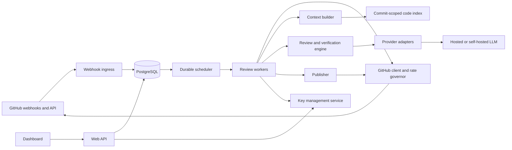

# Open Code Reviewer — system design

> **Status:** final architecture baseline, not an implemented service. **Working name:** Open Code Reviewer. This document defines the product, technical contracts, quality gates, and build sequence for an open source, bring-your-own-model code review service. Decisions can change only in response to implementation evidence or measured user needs. It does not claim that any LLM can prove code correct or that this design reproduces CodeRabbit's private implementation.

## 1. Product contract

A user signs in to the web dashboard with GitHub, installs our GitHub App on selected repositories, and adds an LLM credential or self-hosted endpoint **once**. A team admin can invite members and allow them to run reviews using the admin's key without revealing it. After setup, an authorized member can paste a PR URL and click **Review now** for any repository the app can access and the admin has allowed; enabled repositories can also be reviewed automatically on new pushes. The app posts a GitHub check, a short summary, and evidence-backed inline findings. Users can inspect usage, failures, and feedback in the dashboard. The same open source code can be self-hosted.

“Any LLM key” means **any provider for which an adapter exists**, plus providers that implement the supported OpenAI-compatible API profile. Credentials are not interchangeable: a Gemini key cannot be sent to an Anthropic endpoint, and compatibility does not guarantee equal structured-output or tool behavior. A contributor-facing adapter interface makes adding providers routine.

### One-time setup and everyday use

1. **Admin, once:** sign in; install the GitHub App on selected repositories; add one provider key; create a team; set which members/roles and repositories may use that key, the model, and the spending caps. Optionally enable automatic reviews.
2. **Member, once:** sign in; accept an invitation or apply to join and receive admin approval. No provider key is required for a member using the admin's grant.
3. **Member, per PR:** paste/select an eligible PR and click **Review now**. The backend verifies team permission, GitHub repository access, App installation, key grant, and budget before running one review.
4. **Automatic mode:** when enabled, GitHub PR events trigger reviews using the admin-configured default key policy. The PR author does not need to join the app.

### Product principles

1. **Precision before volume.** A quiet review is preferable to unsupported comments.
2. **Evidence before publication.** The model proposes findings; the system validates them.
3. **Review the current commit.** A result for an obsolete PR head must not be published as current.
4. **Keep cost bounded.** Every review has token, time, file, and money ceilings.
5. **Make limits visible.** A partial review must say which paths or analyses were skipped.
6. **Keep humans responsible.** The bot does not approve PRs or claim that silence means safety.
7. **Make trust boundaries explicit.** Users choose where their code is sent and can self-host.

### Initial scope and deferred scope

| Initial release | Later, after quality and security evidence |
| --- | --- |
| GitHub PRs, GitHub check, summary, inline findings | GitLab, IDE/CLI, suggested patches |
| Web dashboard, personal credentials, admin-to-member key sharing policies, team invites, Review now, per-repo settings | Cross-repository analysis, ticket integrations |
| Release-tested OpenRouter, Gemini, OpenAI, Anthropic, compatible endpoint | Additional tested providers and local inference presets |
| Static context retrieval and optional read-only analyzer imports | Isolated execution of untrusted PR tests |
| Feedback and replayable evaluation | Automated fixes or merge gates |

CodeRabbit's public material describes PR review, context gathering, verification, summaries, and inline comments. It provides a useful product comparison, but our architecture below is independently proposed from public information. See [CodeRabbit's review overview](https://www.coderabbit.ai/review) and [its public context-engineering article](https://www.coderabbit.ai/blog/the-art-and-science-of-context-engineering).

## 2. Assumptions and decisions

- **Initial scale assumption:** hundreds of installations, thousands of repositories, and thousands of PR reviews per day. This is a sizing assumption, not a product limit. One database and horizontally scaled workers are sufficient until measured contention says otherwise.
- **Application stack:** Python FastAPI for the web API and shared domain code; Python async workers for review jobs; React/TypeScript for the dashboard. This keeps provider transport and review logic in one language while the UI remains independent.
- **Deployment:** a hosted multi-tenant service first, with Docker-based self-hosting from the same codebase. Self-hosting still requires a GitHub App registration, database, queue, and model service/key.
- **Identity and ownership:** a GitHub App user token identifies and authorizes dashboard actions; an installation token runs reviews as the app. Every LLM credential belongs to one user. A team admin may deliberately share use of their own key with selected members, repositories, and review modes through a revocable policy; members never see the raw key. A manual request requires current GitHub repository access. A PR webhook uses the repository's configured override or team default key policy, never the PR author's key. GitHub distinguishes user and installation tokens for these purposes. [GitHub App token guidance](https://docs.github.com/en/apps/creating-github-apps/about-creating-github-apps/best-practices-for-creating-a-github-app).
- **Trust:** private source and prompts pass through the hosted service and selected model provider. The dashboard must disclose this before enabling review.
- **Architecture:** modular monolith for API/domain code plus independently scalable workers. One codebase and one set of domain contracts avoid early microservice overhead.
- **Storage and jobs:** PostgreSQL is the durable source of truth and the initial job queue. Workers claim due rows with leases and `FOR UPDATE SKIP LOCKED`; a sweeper recovers expired leases. This is a documented use for queue-like tables. Add Redis or a dedicated broker only when queue contention is measured. [PostgreSQL `SELECT`](https://www.postgresql.org/docs/current/sql-select.html).
- **Model transport:** an internal provider contract owns capabilities and error semantics. LiteLLM Core/SDK is the first transport for its broad provider coverage, called with a per-request credential; direct adapters cover unsupported or unreliable provider features. Never mutate process-global provider keys in multi-tenant workers. LiteLLM documents a broad provider interface and warns that SDK global settings are not thread-safe. [LiteLLM SDK](https://docs.litellm.ai/docs/python_sdk).
- **Agent:** a deterministic planner chooses changed units and budgets; a bounded investigator uses read-only tools to test specific hypotheses. The model cannot call a shell, write code, select a different tenant, or publish directly.
- **Memory:** no general persistent agent memory or vector database. Persist only explicit policy, run metadata, feedback, and short-lived commit-scoped caches.
- **GitHub events:** webhook-driven, not repository polling. GitHub recommends quick acknowledgment and asynchronous work; a webhook receiver should return within 10 seconds. [GitHub webhook practices](https://docs.github.com/en/webhooks/using-webhooks/best-practices-for-using-webhooks).

## 3. System architecture



### Module boundaries

| Module | Owns | Must not own |
| --- | --- | --- |
| Identity and authorization | Sessions, GitHub user identity, installation-admin checks | GitHub review logic |
| Installation sync | App installations, repository grants, uninstall handling | Model credentials |
| Credential vault | Encrypted credential versions, rotation, access policy | Raw source code history |
| Webhook ingress | Signature validation, delivery dedupe, normalized events | Model calls |
| Scheduler | Durable jobs, leases, retries, supersession, fairness | Review content |
| GitHub client | Installation tokens, API limits, fetch and publication API | Finding judgment |
| Context builder | Diff, paths, symbols, bounded related evidence | Final comment wording |
| Provider adapters | Authentication, request/response translation, usage/errors | Repository authorization |
| Review engine | Candidate generation, evidence checks, ranking | Direct GitHub writes |
| Publisher | Current-SHA check, line mapping, idempotent GitHub writes | LLM reasoning |
| Evaluation | Labeled cases, offline replay, metrics | Production credential access |

The worker receives a **review snapshot** identified by `(installation_id, repository_id, pull_number, head_sha, config_version)`. Its outputs are findings and usage records tied to that snapshot. No worker may silently switch to a newer commit midway through analysis.

## 4. Dashboard and public API

### Dashboard pages

1. **Connections:** GitHub account, installations, repository grants, permission health.
2. **My credentials:** add/test/rotate/revoke personally owned keys; only the owner sees provider and masked suffix after save.
3. **Repositories:** connect installed repositories; inherit the team's default key policy or choose an eligible override; set automatic-review policy, instructions, exclusions, thresholds, and budget.
4. **Review now:** paste or select any PR in an authorized installed repository; choose a permitted model and request one review. Show eligibility and estimated budget before starting.
5. **Review runs:** state, requester or webhook trigger, commit SHA, findings, partial coverage, cost/usage charged to the key owner, errors, manual retry.
6. **Feedback:** mark a finding useful, incorrect, duplicate, or already known; inspect how feedback affects future reviews.
7. **Team:** invite or remove people, approve join requests, roles, repository connections, admin key access policies, member and team spending limits, retention, audit events, provider policy.

### API shape

Version internal endpoints under `/api/v1`. Mutations require an authenticated session, CSRF protection where cookies are used, and authorization against the installation/repository. Example resources:

```text
GET    /api/v1/installations
GET    /api/v1/installations/{id}/repositories
POST   /api/v1/credentials                 # write-only secret
POST   /api/v1/credentials/{id}/test
POST   /api/v1/credentials/{id}/rotate
DELETE /api/v1/credentials/{id}
POST   /api/v1/teams/{id}/invitations
POST   /api/v1/invitations/{token}/accept
POST   /api/v1/teams/{id}/join-requests
POST   /api/v1/teams/{id}/join-requests/{request_id}/approve
POST   /api/v1/credential-grants
DELETE /api/v1/credential-grants/{id}
PUT    /api/v1/repositories/{id}/review-config
POST   /api/v1/reviews                     # one manual review from an eligible PR URL
GET    /api/v1/repositories/{id}/review-runs
POST   /api/v1/review-runs/{id}/retry
POST   /api/v1/findings/{id}/feedback
POST   /webhooks/github                   # raw-body HMAC validation
```

Never return plaintext credentials from any `GET`. A successful credential test proves only that a call worked at that moment; it does not prove future quota, billing, or model availability.

## 5. Data model and ownership

| Entity | Key fields and invariants |
| --- | --- |
| `users` | GitHub user ID is stable identity; login/name are display fields. |
| `teams` | Team ID, creator/owner, name, default credential grant ID, status; product teams are separate from GitHub organizations. |
| `team_memberships` | Team ID, user ID, role (`owner`, `admin`, `member`), status; unique active membership. |
| `team_invitations` | Team ID, target GitHub user ID, inviter, hashed single-use token, expiry, status. |
| `team_join_requests` | Team ID, applicant GitHub user ID, request time, status, approving admin; one pending request per user/team. |
| `installations` | GitHub installation ID, account ID, status; removed installations cannot queue work. |
| `installation_members` | User-to-installation role derived/verified from GitHub authority, cached briefly. |
| `repositories` | GitHub repository ID, installation ID, grant status, default branch. |
| `credentials` | Exactly one owner user ID, provider, ciphertext, nonce, wrapped per-credential data key, KMS key ID/version, status, masked suffix; never plaintext. |
| `credential_grants` | Credential ID, granting owner user ID, team ID, allowed member IDs/roles, allowed repository IDs or all connected repos, manual/automatic permissions, limits, status/version; only the key owner creates or revokes. |
| `review_configs` | Repository ID, optional override grant ID (else team default), model, automatic/manual policy, instructions, version, updated-by. One active config per repo. |
| `webhook_deliveries` | Unique GitHub delivery ID, event/action, receipt time, outcome. |
| `review_runs` | Snapshot tuple, trigger (`webhook`/`manual`), requester user ID when manual, selected grant/version, state, attempt, deadline, coverage, config version; unique active run per head/config unless an authorized explicit rerun is requested. |
| `review_tasks` | Per-chunk work items with leases and retry time. |
| `findings` | Run ID, normalized fingerprint, evidence references, line anchor, disposition, publication ID. |
| `usage_records` | Credential version, model, requests, input/output tokens, estimated and reported cost. |
| `audit_events` | Actor, action, target, time; no secrets or source payloads. |

Use immutable review-run records. Store only the minimum source snapshot needed for replay/debugging, with a short default TTL and configurable retention; keep hashes, paths, and usage longer than code contents. On uninstall or credential revocation, stop new work, cancel queued work, and delete cached source according to the retention policy. Do not use a shared cross-tenant code index.

### Team membership, repository access, and who pays

A team owner/admin may invite any GitHub user by username; the server resolves and stores the target GitHub user ID. The invitee signs in with GitHub and accepts a single-use, expiring invitation intended for that ID. A signed-in user may also request to join a team through its join link; an owner/admin approves or rejects the request. Approval creates membership, but team membership alone does **not** grant access to a private GitHub repository or permission to spend an admin's key. Dashboard code/review views require current GitHub repository access; repository configuration requires GitHub repository/installation admin authority as well as the relevant team role. An invited person without GitHub access can manage only their own profile, key, and allowed team-level settings.

| Team role | Team actions | Additional GitHub requirement |
| --- | --- | --- |
| Owner | Invite/remove members, assign admins, configure team policy, share their own key, delete team | Repository admin rights to attach or change a repository. |
| Admin | Invite/remove members, configure team policy, share their own key, set a permitted default key | Repository admin rights to attach or change a repository. |
| Member | Use a key the admin has allowed for them, request Review now, manage any key they personally own | Repository read access to request a review or view private code and findings. |

The key owner can always rotate or revoke their own key and grant regardless of team role. Team admins cannot override that choice or reveal the key.

An admin adds a provider key once, then creates a grant allowing selected members or roles to request reviews, allowing named repositories or all repositories connected to the team, and setting per-review/day/month caps. The admin can set that grant as the **team default**. Authorized members can then use Review now on any eligible PR without entering a key. An authorized GitHub repository admin may select a different eligible grant as a per-repository override. For automatic reviews, the selected repo override or team default is the deterministic payer. For manual reviews, the requester must be allowed by the grant and have GitHub read access to the PR repository. A PR author who is not an authorized member is never charged merely for opening a PR.

If a key owner revokes the grant, leaves the team, deletes the key, or hits a cap, immediately stop new model calls under that grant. Mark an automatic review check `action_required` or `neutral` with a clear configuration reason, then let an authorized admin select another eligible grant. Never silently use a different person's key. Test simultaneous invite acceptance, member removal, grant revocation during a job, and repository removal from the GitHub App installation.

**Example:** Alice creates team `Acme`, installs the GitHub App on `acme/api`, enters her OpenRouter key once, and allows members to use it for any connected `Acme` repository with a monthly cap. She invites Bob. Bob signs in, opens an existing PR in `acme/api`, and clicks **Review now**. The app checks Bob's team permission and GitHub repo access, reviews the PR using Alice's key, and records the usage against Alice's cap. Bob never sees the key. Alice may also enable automatic reviews for that repository; PRs from outside contributors can then be reviewed without those contributors joining the app.

## 6. End-to-end review lifecycle

There are two entry points into the same review pipeline: (a) a GitHub webhook for repositories where automatic review is enabled, and (b) **Review now** from an authorized team member who supplies a PR URL. The manual endpoint parses the URL into a GitHub repository ID and PR number, then checks team membership, the member's GitHub read access, GitHub App installation access, the admin's active key grant, allowed model, and remaining budget. A public PR outside the app's installation can be read for a future preview mode, but v1 does not promise bot publication there; to post a review, the target repository must grant the App the required access. [GitHub App installation scope](https://docs.github.com/en/apps/using-github-apps/installing-a-github-app-from-a-third-party).

If that exact PR head and policy version already has a completed review, Review now shows it first. A deliberate rerun requires a second confirmation that it will consume the admin's budget; repeated clicks with the same request ID do not create duplicate jobs.

“Review anywhere on the PR” means the investigator can inspect every eligible changed file and retrieve relevant unchanged code from that authorized repository. It does **not** mean unlimited full-repository scanning: large PRs still have explicit budgets and partial-coverage reports. GitHub inline review comments require a valid diff location. If an issue is evidenced by unchanged code elsewhere, attach the comment to the causal changed line when valid; otherwise report it in the review summary or check annotation with a path and line reference. Do not invent an inline position. [GitHub review API](https://docs.github.com/en/rest/pulls/reviews), [reviewdog's diff-publication behavior](https://github.com/reviewdog/reviewdog).

```mermaid
sequenceDiagram
  participant G as GitHub
  participant I as Webhook ingress
  participant Q as Scheduler
  participant W as Worker
  participant M as Model adapter
  participant P as Publisher
  G->>I: pull_request event
  I->>I: Verify HMAC and delivery ID
  I->>Q: Upsert latest-head review request
  I-->>G: 2xx acknowledgment
  Q->>W: Lease current snapshot
  W->>G: Fetch PR and commit-scoped context
  W->>M: Bounded candidate analysis
  M-->>W: Structured candidates and usage
  W->>W: Verify evidence, dedupe, rank
  W->>P: Publish findings for snapshot
  P->>G: Recheck head SHA; write review/check
  P-->>Q: Published IDs and terminal state
```

1. Validate the **raw** webhook body with `X-Hub-Signature-256` using constant-time comparison. Reject bad signatures. Deduplicate `X-GitHub-Delivery`; a redelivery carries the same ID. [GitHub validation](https://docs.github.com/en/webhooks/using-webhooks/validating-webhook-deliveries).
2. Accept selected PR actions (`opened`, `reopened`, `synchronize`, `ready_for_review`) and installation changes. A short debounce window coalesces rapid pushes; policy decides whether draft PRs run.
3. Persist the event and a `queued` run in one transaction, then acknowledge. A reconciliation process inspects failed webhook deliveries and stuck jobs after outages.
4. A worker obtains a lease, confirms installation/repository/config access, and creates or updates a GitHub check as `in_progress`.
5. Fetch PR metadata, base/head SHAs, paginated changed files, patches, and bounded source context. GitHub's list-files API caps responses at 3,000 files; a larger PR is explicitly partial. [GitHub pull request files API](https://docs.github.com/en/rest/pulls/pulls).
6. Build a risk-ranked review plan and reserve a model budget. Analyze selected chunks, then verify candidates.
7. Before publication, fetch the PR head again. If it differs, mark the run `superseded`, do not publish its findings, and enqueue the latest head.
8. Publish one review with a short summary and high-confidence inline comments where possible; update the check. GitHub review comments must map to valid changed diff lines and a commit ID. [GitHub reviews API](https://docs.github.com/en/rest/pulls/reviews).

### Run states

```text
queued -> debouncing -> fetching -> planning -> analyzing -> verifying
       -> publishing -> completed | partial
Any active state -> waiting_rate_limit | waiting_provider | superseded | failed | cancelled
Waiting states -> prior resumable state, within bounded retry/deadline policy
```

Every state transition is recorded with a reason code and timestamp. A lease timeout returns work to the queue; idempotency keys prevent duplicate comments. `partial` is a successful but incomplete review, never represented as full coverage.

## 7. How review quality and correctness are handled

**There is no general way to guarantee code correctness from a PR diff.** Tests can be incomplete; static analyzers cover selected classes of problems; models can miss bugs and invent them. The service should make defensible claims: “these findings have evidence” and “these checks ran,” not “this code is correct.” A study of LLM code review found meaningful error rates and recommended a human-in-the-loop process; SWE-bench illustrates the difficulty of multi-file software reasoning. [Evaluating Large Language Models for Code Review](https://arxiv.org/abs/2505.20206), [SWE-bench](https://arxiv.org/abs/2310.06770).

### Finding policy

Prioritize actionable defects introduced or exposed by this change:

- Incorrect behavior under a concrete input or state.
- Security boundary violations with a credible path from input to impact.
- Broken API/schema compatibility, data loss, concurrency races, or resource leaks.
- Missing tests only when they protect a specific high-risk behavior.

Suppress generic style advice, speculative performance claims without scale evidence, comments already covered by CI, and findings that depend on assumptions the available context cannot support. The summary may mention unverified questions separately from inline defects.

### Code-quality assessment

Assess a **change against the repository's baseline and stated behavior**, rather than assigning an opaque universal “quality score.” A review separates these dimensions:

| Dimension | Primary evidence | When to comment |
| --- | --- | --- |
| Correctness | Diff, callers, contracts, tests, reproducible counterexample | A specific input/state makes changed behavior wrong. |
| Security | Trust boundary, data flow, existing scanner signal, exploit preconditions | A plausible path from attacker-controlled input to impact exists. |
| Reliability | Error paths, timeouts, retries, transactions, concurrency | A concrete failure mode or unsafe retry is introduced. |
| Maintainability | Existing local pattern, public interface, duplication, complexity delta | The change creates a clear future defect or materially obscures behavior; avoid taste-only remarks. |
| Performance | Algorithmic work, I/O count, allocations, measured profile/benchmark | There is a credible scale scenario or measurement, not just a hunch. |
| Test adequacy | Changed behavior and current test coverage | An important new branch or regression risk is untested. |

Start with existing CI checks and repository-configured linters/type checkers; read their results before asking a model to restate them. GitHub exposes check runs for a commit, and CodeQL can provide rule-based security and quality findings when the repository has it configured. Do not assume these tools are present or licensed for every repo. [GitHub checks API](https://docs.github.com/en/rest/checks/runs), [CodeQL quality analysis](https://docs.github.com/en/code-security/reference/code-quality/codeql-detection).

For each proposed issue, require a changed-line anchor, concrete trigger and consequence, and evidence that it is new or worsened relative to the base commit. Use static-tool output as independent evidence or to suppress duplicates; a clean linter is not evidence that behavior is correct. Repository-specific rules may raise or lower comment thresholds, but never authorize unsupported claims. Do not run arbitrary PR scripts in the normal worker; future execution belongs in an ephemeral sandbox with no tenant secrets.

### Candidate schema

```text
CandidateFinding {
  category, severity, confidence,
  path, changed_line, side,
  claim, preconditions, failure_scenario,
  evidence: [{path, commit_sha, line_start, line_end, reason}],
  suggested_remedy,
  verification_status
}
```

The model is asked to return **zero findings** when it has no supported issue. Its numeric confidence is a ranking hint, not a calibrated probability. Schema parse failure triggers one bounded repair attempt, then a visible degraded result.

### Verification gates before publication

1. **Structural:** schema valid; path and line exist; anchor is a changed line in the reviewed commit; no secret-like content in comment.
2. **Causal:** finding describes behavior caused or exposed by the patch, not an old unrelated defect.
3. **Evidence:** inspect the cited source, callers/tests/contracts, and attempt to disprove the claim. If evidence is missing, retrieve a bounded extra slice or suppress.
4. **Independent signal:** compare with compiler/test/static analysis output when available. Optional isolated tests may be introduced later; do not execute untrusted PR code inside the normal worker.
5. **Novelty:** fingerprint by root cause, path/symbol, and relevant diff; suppress duplicate findings across chunks and prior runs.
6. **Policy:** severity, confidence, repository instruction, and comment-cap checks.
7. **Freshness:** recheck head SHA immediately before GitHub write.

A second model call can act as an adversarial verifier for expensive/high-impact candidates, but it is **not proof**. Prefer independently observable evidence over a model agreeing with itself. Where the claim cannot be validated, lower confidence or omit the inline comment. Publish a maximum number of comments per review (initial default: 5), adjustable only after measuring precision.

### Review output

```text
Summary: what changed and the primary risk areas
Coverage: files reviewed / excluded / skipped, model and check status
Findings: concise inline comments with trigger, consequence, and fix direction
Limitations: partial review, missing tests, unavailable provider, or inaccessible context
```

Avoid a “passed” check that implies code is safe. Use a neutral completed check for a clean review; reserve a failing conclusion for a configurable, evidence-backed severity policy. Human approval remains required by repository policy.

## 8. Context engineering

Large context windows are useful but do not remove retrieval and attention problems. The [Lost in the Middle](https://arxiv.org/abs/2307.03172) paper reports poorer use of relevant information buried in long inputs. A [context-rich code-review benchmark](https://arxiv.org/abs/2511.07017) explicitly includes surrounding function/class and issue context. Therefore the system should select small, high-value evidence bundles instead of dumping an entire repository into one prompt.

### Four context layers

| Layer | Contents | Loading rule |
| --- | --- | --- |
| 0: invariants | Review objective, output schema, security/policy, current commit | Always; compact and stable |
| 1: change | PR title/body, base/head, diff hunks, touched tests, changed symbols | Always for selected chunks |
| 2: local code | Enclosing function/class, imports, types/interfaces, nearby tests/config | Retrieve on demand |
| 3: wider evidence | Callers/callees, schema/API consumers, relevant docs, prior related decisions | Only when a concrete question needs it |

### Retrieval procedure

1. Parse the diff into files and hunks. Detect language, generated/binary/lockfile status, renamed files, and changed symbols (Tree-sitter where reliable; fallback to text/grep-style indexing).
2. Build a commit-scoped symbol/import/reference index. The PR diff and exact SHA remain authoritative; the index is only a navigation aid.
3. Rank files and hunks using deterministic signals: changed executable code, public interfaces, auth/data paths, dependency edges, test gaps, and repository configuration. Do not use file name alone as a security classifier.
4. Allocate a per-PR budget, then per-chunk budgets. Reserve room for model output and verification. Define defaults in config rather than promising a fixed token count across models.
5. Give each analysis call a coherent unit: one function or small connected group of hunks plus just enough surrounding definitions and tests. Place requirements and target diff prominently; cite context with paths and SHA.
6. If an apparent issue needs more context, issue a specific retrieval query (`find callers of X`, `read interface Y`, `find tests for endpoint Z`) within a bounded depth and token cap. Preserve a trace of what was retrieved and why.
7. Compress only low-risk background context into short, source-linked summaries. Do not summarize the target diff or cited lines before verification. Mark model-generated summaries as untrusted.
8. For huge PRs, split by dependency/component, review highest-risk chunks, and report coverage. Never silently truncate.

### Where Tree-sitter fits

**Use Tree-sitter for syntax-aware navigation, not as the whole context system.** Parse the exact base and head versions of changed files for supported languages. Map each changed line to its smallest useful enclosing function, method, class, or module-level declaration; extract declarations, imports, call sites, and test names with versioned language-specific queries. Store `(repository_id, commit_sha, path, byte_range, line_range, symbol_name, grammar_version)` for each extracted span. Tree-sitter queries and tagging support these captures, and parse trees can still contain useful structure when syntax errors exist. [Tree-sitter code navigation](https://tree-sitter.github.io/tree-sitter/4-code-navigation.html), [query syntax](https://tree-sitter.github.io/tree-sitter/using-parsers/queries/1-syntax.html).

Tree-sitter gives **syntactic** facts, not a guaranteed type-resolved call graph or proof that two same-named functions refer to each other. For imports, dynamic dispatch, generated code, macros, and framework wiring, use repository search, manifests, schema/config files, test names, and optionally language-server/compiler data when available. Label inferred edges with their source and confidence. Do not promote a guessed edge into a finding without reading the target evidence.

The context planner for a changed hunk should:

```text
1. Load the exact diff hunk and enclosing symbol at head_sha.
2. Add imports, signatures/types, and adjacent tests within a small local budget.
3. Form a review question (for example, "does this new authorization path enforce tenant ownership?").
4. Retrieve only the caller, callee, policy, or test needed to answer that question.
5. Stop at a configured hop/token/time limit; record what was skipped.
6. Keep exact cited source lines for verification and publication.
```

Use Tree-sitter only where a pinned grammar and queries pass fixtures. If the language is unsupported or the parse has errors near the changed region, fall back to diff hunks, bounded file windows, and exact search. Parse failure reduces context quality; it must never silently drop the changed code. Cache parse/index artifacts by commit SHA so incremental PR reviews reuse unchanged files. Parser spans are for retrieval; GitHub's diff remains the authority for inline comment positions.

### Read-only tool surface for the review agent

Expose narrow, audited tools rather than a general shell. Every result includes repository ID, commit SHA, path, line span, truncation flag, and remaining budget. Normalize paths and enforce the installation's repository grant in the tool server, not in the prompt. These are logical tool contracts; implementations may use `rg`, a code index, GitHub APIs, or local commit snapshots.

| Tool | Example input | Best use |
| --- | --- | --- |
| `glob_files` | `**/*auth*`, `tests/**` | Discover candidate paths; cap matches and exclude generated/vendor trees. |
| `grep_content` | Exact symbol, error text, config key | Search text across permitted files; return bounded matching lines and paths. |
| `read_file_span` | Path + line range + SHA | Read exact source evidence without loading a whole file. |
| `read_diff` | PR head/base + path/hunk | Establish what actually changed and legal inline anchors. |
| `list_symbols` | Path + SHA | Tree-sitter-derived definitions and spans for supported languages. |
| `find_references` | Symbol + scoped paths | Candidate callers/usages, with a label that text matches are not resolved references. |
| `read_tests` | SHA + path/symbol | Find test cases and fixtures related to changed behavior. |
| `read_ci_results` | SHA + check name | Read existing check runs, test failures, and analyzer annotations without rerunning code. |
| `read_repo_rules` | Repository + path | Versioned project rules applicable to the changed code. |
| `read_manifest` | Path + SHA | Read pinned dependency versions, scripts, and build configuration. |
| `read_git_history` | Path/symbol + bounded commit range | Understand why a contract or edge case exists; never treat old code as current evidence. |
| `fetch_public_docs` | Package/version + precise question | Optional official external docs when a finding depends on an API contract. |

Typical route: `read_diff` → `glob_files` to find likely tests/config → `grep_content` for exact names → `list_symbols`/`read_file_span` to inspect definitions → `find_references` only if the claim depends on a caller → `read_tests`/`read_ci_results` → verify. Read manifests when dependency versions affect a claim; read history only when intent or regression behavior is unclear. The agent can ask for another bounded slice if evidence is insufficient. It must stop at per-tool and per-review call, byte, token, and time limits. Web retrieval is off by default for private code and must never put private source, secrets, or internal issue text in a public query.

The planner runs before the model and records eligible files, risk order, and remaining budget. The investigator may request at most two dependency hops and three evidence-retrieval rounds per candidate by default; exceeding a limit yields an unresolved question, not a fabricated conclusion. Tool outputs are data with provenance, never instructions. The verifier sees the exact cited spans, the diff, and contrary evidence; the publisher sees only verified findings. This separation prevents one model response from authorizing its own GitHub write.

**No blanket repository embedding requirement for v1.** Exact path/symbol search and commit-scoped graph traversal are easier to audit and often cheaper. Add lexical/semantic retrieval only when evaluation shows a measured gap. Cross-repo retrieval needs explicit authorization for both repositories and is deferred.

### Incremental review and memory

**No general persistent agent memory in v1.** Each PR review starts from the current commit, repository rules, and explicit prior review state. An LLM-written memory store or vector database would risk stale conclusions, cross-repository leakage, and growing context cost without a measured need.

| State | Storage and lifetime | Purpose |
| --- | --- | --- |
| Per-run working notes | Job state, deleted at completion or short diagnostic TTL | Track questions, retrieved spans, candidate findings, and remaining budget within one review. |
| Commit-scoped cache | Tenant-isolated, short TTL, keyed by SHA and parser version | Reuse parsed files and exact source spans on rapid PR updates. |
| Durable review metadata | PostgreSQL under retention policy | Prevent duplicate comments; support audit, usage, and feedback. |
| Repository policy | Versioned, admin-approved configuration | Apply stable project instructions and exclusions. |
| Optional learnings | Human-approved, source-linked, scoped to repository/team, with expiry/review | Capture a repeated local rule only after evidence shows it helps. |

On a new push, compare the last reviewed head to the current head. Reuse stable, commit-addressed context and reconsider earlier findings only if their evidence or affected code changed. Never blindly repost prior comments. Raw chat history, prior model speculation, and old PR summaries are not automatically fed back into the prompt. A past finding is a navigation clue; the new commit's source is the authority. Evaluate any future semantic memory against a no-memory baseline for precision, privacy, cost, and freshness before adding it.

## 9. Provider layer: any supported LLM

```text
ProviderAdapter {
  validateCredential(input) -> capability/result
  listModels?() -> models
  capabilities(model) -> context, structuredOutput, usage, limits
  generate(request, credential, deadline, idempotencyKey) -> text/structured + usage
  classifyError(error) -> transient | rate_limited | quota | auth | invalid_request
}
```

Adapters own HTTP protocol details, token/usage normalization, timeouts, and provider-specific errors. They do **not** choose which tenant's key to use. The review engine owns prompts and finding semantics. Pin a model identifier and adapter version in each run for reproducibility.

Initial provider support:

- **OpenRouter:** one user-owned OpenRouter key and selected model. OpenRouter is a routing/API service, not itself an open source model; it can expose open-weight and proprietary models. Its chat API includes model and usage fields. [OpenRouter chat API](https://openrouter.ai/docs/api/api-reference/chat/send-chat-completion-request).
- **Gemini, OpenAI, and Anthropic direct:** selectable user-owned keys routed through the provider contract. Use LiteLLM transport where its contract tests pass; use a direct native client for provider-specific gaps. These four named routes are release-tested, not just displayed in a model catalog.
- **Long-tail providers:** expose LiteLLM-supported providers only after per-provider capability and credential tests pass. LiteLLM's broad catalog is a transport advantage, not a promise that every model performs useful code review. [LiteLLM providers](https://docs.litellm.ai/docs/providers).
- **OpenAI-compatible endpoint:** configurable base URL/model/auth for compatible services, including self-hosted models; require an explicit network allowlist for hosted deployments. Do not infer full compatibility from the URL alone.

Pass decrypted keys as per-request parameters and never set process-global environment variables for tenant credentials. Disable prompt/response logging and SDK callbacks unless explicitly configured and audited. Capability tests should check authentication, a tiny generation, structured-output behavior, and usage reporting. A model that cannot reliably produce parseable findings may still generate summaries, but should be marked unsuitable for inline review. Provider fallback is **opt-in** because switching provider may change cost, quality, and data handling. Run contract tests whenever the transport library or provider API changes.

## 10. Scheduling, quotas, rate limits, and cost

There are three independent budgets:

| Budget | Scope | Control |
| --- | --- | --- |
| GitHub primary/secondary API | Installation and global app traffic | Header-aware pacing, low write concurrency, delayed retries |
| LLM provider | Credential/project/model, sometimes provider account | Request and estimated-token reservations; provider error classification |
| User cost | Key owner/grant/repository/PR | Token, currency estimate, file and time limits |

GitHub installation tokens have a documented primary REST rate limit that starts at 5,000 requests/hour for typical installations, plus secondary limits. Do not rely on that figure alone: obey response headers and handle `403`/`429`. GitHub advises pausing after `Retry-After` or reset, and pacing write requests. [GitHub rate limits](https://docs.github.com/en/rest/using-the-rest-api/rate-limits-for-the-rest-api), [REST best practices](https://docs.github.com/en/rest/using-the-rest-api/best-practices-for-using-the-rest-api).

Gemini quotas may apply to requests/minute, input tokens/minute, and requests/day **per project rather than per key**; the credential UI must not imply that two keys always mean two quotas. [Gemini limits](https://ai.google.dev/gemini-api/docs/rate-limits). OpenRouter and its upstream providers may also limit requests; free and paid model behavior differs. [OpenRouter pricing and limits](https://openrouter.ai/pricing).

### Scheduler rules

- Use installation-aware and credential-aware queues with weighted fair scheduling, so one large tenant cannot starve others.
- Coalesce updates for the same PR. Invalidate older queued runs when a new head arrives; a running old run can finish analysis but cannot publish.
- Reserve estimated input/output tokens before a provider call, then reconcile actual reported usage. When usage is unavailable, apply a conservative estimate and show it as estimated.
- Limit concurrent calls per credential and per installation. Keep global provider limits configurable.
- On rate limit, persist `next_attempt_at`; release the worker. Honor `Retry-After`/reset headers first, otherwise exponential backoff with jitter. Cap attempts and deadline.
- On invalid key, forbidden model, depleted credits, or quota that will not recover soon, mark actionable `needs_configuration`; do not retry indefinitely.
- Place a circuit breaker around a failing provider/model. Do not secretly route private code to a different provider.
- Count every model call, including verification and retries, against the PR and grant-owner budgets. Reserve a conservative worst-case amount before each call; block new calls when the app-side cap would be exceeded. Actual provider billing can differ from estimates, so disclose that an app cap is not a provider-side billing guarantee.

Cost estimate: `input_tokens × input_price + output_tokens × output_price + provider-specific fees`. Model prices change, so refresh catalog prices when available, store the price/version used for each estimate, and label estimates. Never present an inferred cost as a billed amount.

## 11. Security and privacy threat model

| Threat | Control |
| --- | --- |
| Forged/replayed GitHub webhook | Raw-body HMAC-SHA256 verification; unique delivery ID; HTTPS. |
| Wrong tenant's key or source used | Installation/repository/credential ownership checks at API, queue, and worker boundaries; row-level authorization tests. |
| Key exposure | Envelope encryption/KMS, write-only API, masked display, no secret logging, rotation and revocation. |
| Prompt injection in code, PR description, or rules | Treat repository material as data; fixed higher-priority system policy; no unrestricted tools; validate every action server-side. |
| Self-hosted endpoint SSRF | Deny private/link-local/metadata IPs and redirects to them; DNS recheck; tenant allowlist or egress proxy. Self-hosters may configure their own network policy. |
| Untrusted PR code execution | No execution in normal workers. Later use ephemeral sandbox, no secrets, restricted network, resource/time caps. |
| Provider data disclosure | Explicit provider/model selection and privacy notice; no silent fallback; per-organization provider policy. |
| Stale/incorrect review publication | Commit SHA recheck, diff-line validation, publication idempotency. |
| Cross-tenant cache leakage | Cache key includes installation, repo, SHA, visibility; tenant isolation and TTL. |
| Abuse/cost exhaustion | Per-user/repo/installation limits, key ownership, spending caps, job fairness. |

### Hosted user API-key lifecycle

The hosted service must be able to use a customer's API key, so it cannot truthfully claim that it never sees the key. The trust contract is that only the authorized API path accepts it and only the authorized worker decrypts it for a provider call. A user who cannot accept that trust boundary can self-host with their own key-management system.

1. **Create:** the dashboard sends the key once over HTTPS to an authenticated, CSRF-protected write endpoint. The API creates it only under the signed-in user's ownership; there are no team-owned keys. The key is never placed in a URL, analytics event, browser local storage, or application log.
2. **Encrypt:** generate a fresh random data-encryption key (DEK) for this credential version. Encrypt the provider key with a maintained AES-256-GCM library; bind owner ID, credential ID, provider, and version as authenticated associated data. Wrap the DEK with a cloud KMS key. Store ciphertext, nonce, authentication tag, wrapped DEK, KMS key ID, and nonsecret metadata in PostgreSQL. The KMS key itself never enters the database. This follows standard envelope-encryption guidance. [Google Cloud KMS envelope encryption](https://docs.cloud.google.com/kms/docs/envelope-encryption), [OWASP cryptographic storage](https://cheatsheetseries.owasp.org/cheatsheets/Cryptographic_Storage_Cheat_Sheet.html).
3. **Share and select:** the admin who owns the key grants selected members/roles permission to request reviews, selects eligible repositories or all team-connected repositories, allows manual and/or automatic mode, and sets caps. The admin can make it the team default once; an authorized repository admin can configure an eligible override. The job queue stores a grant ID and credential version, never the raw key. Membership alone is not permission to use the key.
4. **Use:** the worker rechecks installation access, repository eligibility, active grant, credential status, and owner budget. For a manual run it also rechecks the requester's team permission and GitHub repository access; for a webhook run it checks the repository's automatic-review policy. It unwraps the DEK through KMS using a worker-only decrypt role, decrypts the key in process memory, and passes it as a per-request parameter to the selected provider transport over TLS. The web API has encryption authority but no routine KMS decrypt authority. Do not persist plaintext in process globals, shared cache, trace attributes, exceptions, or retry payloads. Python cannot guarantee immediate zeroization of all copies in memory, so process isolation and short-lived use are part of the defense.
5. **Rotate:** accepting a replacement key creates a new encrypted version and atomically points the repository binding to it. New jobs use the new version; an in-flight old job must either finish within a short grace window or be cancelled. Log who rotated the credential without logging the key.
6. **Revoke/delete:** disable the credential immediately, cancel queued jobs, prevent new decrypts, and delete active ciphertext and wrapped DEK under the retention policy. Deleting the app's copy does not revoke the key at the LLM provider; tell the user to revoke it there too. Encrypted backups expire on a documented schedule.

Audit credential creation, binding, use, rotation, and revocation by IDs and timestamps only. Alert on unusual decrypt volume or cross-tenant authorization failures. Test a database-only breach (ciphertext remains unreadable), a worker authorization bypass, logging redaction, backup restore, and rotation during active jobs. OWASP treats provisioning, rotation, revocation, and logging as one secret lifecycle. [OWASP Secrets Management](https://cheatsheetseries.owasp.org/cheatsheets/Secrets_Management_Cheat_Sheet.html).

GitHub App permissions should be limited to what the product uses: Pull requests read/write, Contents read when source context is needed, and Checks write for check runs, subject to endpoint-specific verification during implementation. Installation access tokens expire after one hour; refresh on demand and never persist them as durable credentials. [GitHub App best practices](https://docs.github.com/en/apps/creating-github-apps/about-creating-github-apps/best-practices-for-creating-a-github-app), [installation tokens](https://docs.github.com/en/apps/creating-github-apps/authenticating-with-a-github-app/generating-an-installation-access-token-for-a-github-app), [checks API](https://docs.github.com/en/rest/checks/runs).

OpenRouter can route code to upstream providers with different data practices; the dashboard must expose the chosen route/provider policy and link to current terms. [OpenRouter privacy policy](https://openrouter.ai/privacy/).

## 12. Reliability, observability, and operations

### Failure behavior

| Failure | User-visible result | Recovery |
| --- | --- | --- |
| Webhook API outage | Delivery absent or failed | Reconcile/redeliver missed GitHub deliveries; idempotent ingest. |
| Worker crash | Run remains nonterminal briefly | Lease expiry and retry without duplicate publication. |
| GitHub rate limit | `Waiting for GitHub` | Persist retry time from headers. |
| Model 429/5xx | `Waiting for provider` | Bounded retry with jitter; preserve cost ledger. |
| Invalid/revoked key | `Action needed` | Notify credential owner; pause affected repo config. |
| PR updated during run | `Superseded` | Start current SHA, discard old publication. |
| Context/file limit | `Partial review` | Report exact skipped files/reasons; manual retry with larger approved budget. |
| GitHub comment line invalid | Summary-only fallback for that finding | Refresh diff map; do not guess a line. |

### Metrics and traces

Record queue delay, fetch/analyze/verify/publish time, GitHub requests and remaining quota, model latency and token usage, cost estimate, partial-review fraction, retry reasons, duplicate suppression, current-SHA publication rate, and feedback-based precision. Trace by `review_run_id` and include installation/repository **IDs** rather than source or secrets. Alert on stuck jobs, elevated 429s, publication failures, and spend anomalies.

Initial service objectives are **targets to validate in beta**, not promises: 99% of accepted webhook deliveries durably queued; 99.9% of published comments anchored to the current checked SHA; zero known cross-tenant key/source leaks. Review latency should be reported by PR size and provider rather than one misleading global average.

### Deployment

- Hosted: stateless web API, worker pool, PostgreSQL, KMS/secret manager, optional Redis, object storage only for short-lived encrypted context artifacts if needed.
- Self-hosted: documented container deployment with PostgreSQL and a durable queue implementation; external KMS optional but encrypted secret storage mandatory.
- Database migrations are versioned and reversible where possible. Use rolling deployment with old/new worker compatibility across one schema version.
- Backup database and encryption key material separately; test restore. Deleting a tenant must remove associated cached code and encrypted credentials.

## 13. Evaluation and research plan

Quality must be measured at the **product pipeline** level, not inferred from the model name. Construct an evaluation corpus of consented or public PRs with known defects, clean PRs, multiple languages, large diffs, generated files, and stale-update scenarios. Keep repository and time splits so near-duplicate changes do not leak between tuning and test sets. Human reviewers adjudicate whether each finding is correct, caused by the change, useful, and well anchored.

| Metric | Definition |
| --- | --- |
| Precision | Valid actionable findings / published findings; report by severity and language. |
| Recall | Known target defects found / known target defects; acknowledge incomplete labels. |
| False positives per PR | Incorrect or irrelevant comments / reviewed PRs. |
| Useful finding rate | Findings marked useful or accepted by human reviewers. |
| Duplicate rate | Repeated root-cause comments across chunks or pushes. |
| Anchor accuracy | Comments attached to the intended changed line and current SHA. |
| Coverage | Reviewed executable changed lines/files / eligible changed lines/files. |
| Cost and latency | Per PR and per valid finding; p50/p95 by PR size/model. |

Compare these ablations on the same held-out set: diff-only, diff plus local context, graph retrieval, verifier on/off, deterministic tool signals on/off, and different models under equal budgets. Run “clean PR” controls because a model that always comments may look good on bug-heavy data. Do not optimize solely for benchmark score; review quality is partly contextual and human judged. A survey of review benchmarks notes gaps in task coverage and runtime evaluation. [Code review benchmark survey](https://arxiv.org/abs/2602.13377).

Before a public “high confidence review” claim, run a blinded human adjudication on held-out PRs from multiple repositories and languages. The proposed release gate is at least 80% precision for published high/critical comments, with false positives and partial coverage disclosed beside it. This is a target to test, not a measured result or a guarantee. Report confidence intervals and per-language sample counts; do not hide clean PRs or failed runs from the denominator. Evaluate the verifier separately on deliberately plausible but false comments.

### Research-to-design mapping

| Public source | What it supports | What it does **not** prove |
| --- | --- | --- |
| [CodeRabbit context article](https://www.coderabbit.ai/blog/the-art-and-science-of-context-engineering) | Context gathering and verification are useful design patterns. | Its full private architecture or our performance. |
| [Lost in the Middle](https://arxiv.org/abs/2307.03172) | Avoid indiscriminate long prompts; position relevant evidence. | One universal token budget or retrieval algorithm. |
| [ContextCRBench](https://arxiv.org/abs/2511.07017) | Surrounding code and task context matter in review evaluation. | That its dataset represents every production language/repo. |
| [LLM code-review evaluation](https://arxiv.org/abs/2505.20206) | Model judgments can be wrong; use human oversight. | Our expected precision on real PRs. |
| [SWE-bench](https://arxiv.org/abs/2310.06770) | Multi-file reasoning is a real software-engineering challenge. | A direct code-review leaderboard. |
| [CR-Bench](https://arxiv.org/abs/2603.11078) | Spurious findings and issue discovery must be measured together. | A universal quality score for this product. |
| [c-CRAB](https://arxiv.org/abs/2603.23448) | Real PR review remains difficult for current agents; test-based tasks can complement human labels. | That matching prior human comments captures every valid issue. |
| [CRJudgeBench](https://arxiv.org/abs/2609.37216) | Plausible invalid comments are a distinct verification problem. | That a model verifier proves a comment correct. |
| [PR-Agent review documentation](https://github.com/The-PR-Agent/pr-agent/blob/main/docs/docs/tools/review.md) | Chunking large PRs and tracking prior resolved findings are practical patterns. | That its settings or private performance transfer to this service. |
| [reviewdog](https://github.com/reviewdog/reviewdog) | Diff filtering, standard analyzer formats, and check annotations are useful publication patterns. | That linter findings alone replace semantic review. |

## 14. Build plan and acceptance gates

### Milestone 1 — functional GitHub loop

Implement GitHub sign-in, App install/sync, encrypted personal-key vault with one tested provider, verified webhook ingestion, durable queue, PR fetch, **Review now** for that key, check run, and a summary-only review. **Accept when:** a signed-in repository reader can request one review of an installed PR; an unauthorized user or uninstalled repository is rejected; plaintext keys never enter jobs or logs; duplicate/redelivered webhooks create one logical run; a new push supersedes the old SHA; installation removal stops work.

### Milestone 2 — credentials and providers

Extend the personal-key vault with rotation and deletion; implement team invitations and join-request approval, admin-to-member key grants, team default and repository overrides, release-tested OpenRouter/Gemini/OpenAI/Anthropic routes, compatible endpoint with safe egress, credential/capability tests, and usage ledger. **Accept when:** an approved member can request Review now with the admin's key on any permitted installed PR without seeing the key; a repository can spend only its selected active grant; team membership alone cannot spend or reveal a key; revocation stops new calls; rotation does not expose or break old in-flight run accounting; auth/quota errors are actionable; concurrent tenants never share a provider key through SDK globals.

### Milestone 3 — high-signal review

Implement diff parser and line mapper, context retrieval, risk planner, structured candidates, verification gates, dedupe, summary plus inline comments. **Accept when:** every published inline comment is on a valid changed line of the checked SHA and cites evidence; zero-finding reviews produce no filler comments; partial coverage is explicit.

### Milestone 4 — production reliability

Implement rate governors, durable delayed retries, fairness, spend caps, reconciliation, audit/metrics, deletion, and self-hosted docs. **Accept when:** load tests with injected 429/5xx/worker crashes do not lose jobs or duplicate comments; caps cannot be bypassed by retries; tenant isolation tests pass.

### Milestone 5 — evidence of quality

Publish a reproducible evaluation harness and consented/public benchmark set with human adjudication. **Accept when:** precision, recall proxy, false positives, cost, latency, and coverage are reported by language and PR size, with model and prompt versions pinned. Only then claim a measured quality advantage over a comparator.

### Repository layout when implementation begins

```text
apps/dashboard/            React/TypeScript dashboard
src/reviewer/api/          FastAPI routes, auth, webhook ingress
src/reviewer/jobs/         PostgreSQL scheduler, leases, workers
src/reviewer/github/       App auth, API client, diff mapping
src/reviewer/providers/    Adapter contract and model transports
src/reviewer/core/         Planner, context, candidates, verification
src/reviewer/security/     Authorization, vault, egress policy
src/reviewer/db/           Schema access and migrations
eval/                      Replay harness, labels, scoring
deploy/                    Hosted and self-hosted deployment templates
docs/                      Threat model, operations, contributor guides
```

## 15. Open source governance

Choose a permissive license such as Apache-2.0 after checking dependencies and contributor preferences. Publish the full hosted-path source, schema, migrations, provider adapter API, evaluation harness, and deployment files. Keep secrets and production configuration outside the repository. Require tests for provider adapters, authorization boundaries, diff mapping, retry semantics, and publication idempotency. Document how to contribute an adapter, including capability tests and error classification. Security reports need a private disclosure channel; ordinary issues and architectural decisions can be public.

The hosted service pays for compute, storage, and operations; BYOK users pay their selected inference provider. Self-hosting shifts operations to the adopter. Neither mode guarantees free inference, unlimited provider quotas, or code correctness.

## 16. Final v1 defaults and change criteria

| Decision | V1 default | Change only when |
| --- | --- | --- |
| Credential sharing | Every key has one user owner. An admin can share use of their own key with selected team members/roles and connected repositories, with caps; the admin can set it once as the team default. The key itself is never shown to members. Revalidate grant and access on every run. | Organization testing shows a required additional delegation role. |
| Model selection | Admin sets allowed tested provider/models for the shared key; a member chooses only among those. No hidden provider fallback or universal “best” model. | Held-out PR evaluation supports a default recommendation by language/cost tier. |
| Review mode | Review now is available after one-time setup on eligible installed PRs; automatic review on opened/reopened/updated ready PRs is an admin opt-in; drafts opt-in; comments only on current head SHA. | User feedback or GitHub constraints justify another trigger. |
| Merge behavior | Neutral check by default; no automatic approval and no merge blocking. | High-severity precision and administrator demand support opt-in blocking. |
| Context | Diff + exact search + Tree-sitter where tested; two dependency hops maximum initially; explicit partial coverage. | Retrieval ablations show more depth improves valid findings enough to justify cost. |
| Agent tools | Read-only, bounded, audited; no general shell or arbitrary MCP server in the hosted service. | A sandbox and threat-model review make a new capability safe and useful. |
| Memory | No autonomous persistent memory; repository policy and prior finding IDs only. | A no-memory comparison shows durable learnings improve precision without stale or private-data leakage. |
| Source retention | Commit-scoped source cache expires within 24 hours by default; no persistent full-repository mirror. | A tenant explicitly configures a different policy and deletion tests pass. |
| Metadata retention | Review/usage metadata retained 90 days by default, with tenant deletion; GitHub comments follow GitHub's retention. | Product/legal needs establish another documented policy. |
| Languages | Symbol-aware queries for TypeScript/JavaScript, Python, and Go first; text fallback for others. | Grammar fixtures and evaluation justify adding another language. |
| Queue | PostgreSQL jobs with leases and `SKIP LOCKED`. | Observed contention/throughput requires a broker. |

The design is complete enough to begin implementation. Model choice, quality thresholds, and scaling numbers remain empirical parameters: they must be calibrated on real PRs, not guessed from vendor claims. The first build step is Milestone 1, with the authorization and credential contracts established before broader model support.

---

This document is the architecture baseline. Each implementation milestone must preserve its security, cost, freshness, and review-evidence invariants or record an explicit design change.
